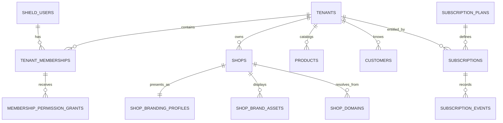
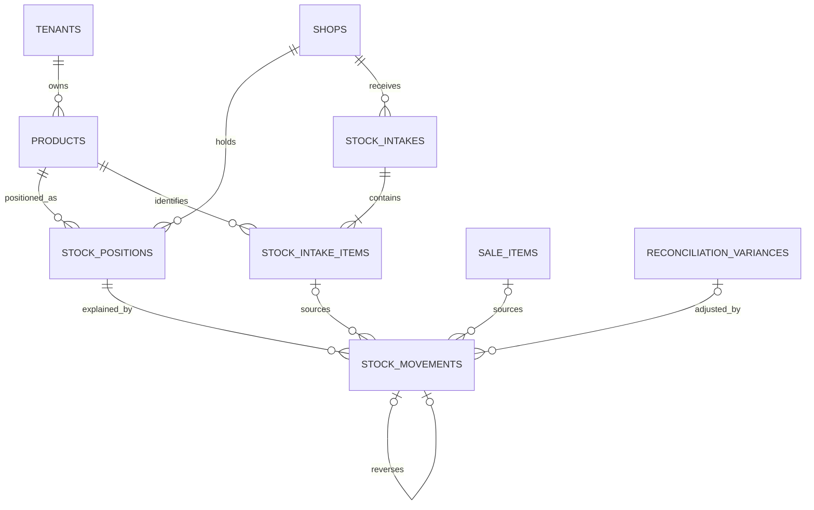
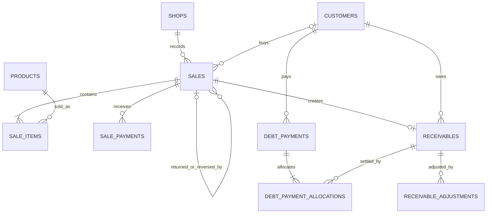
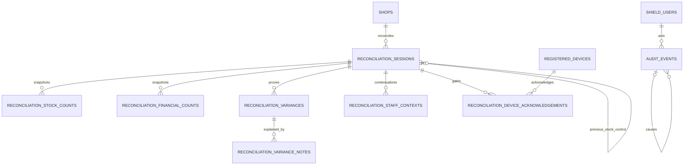
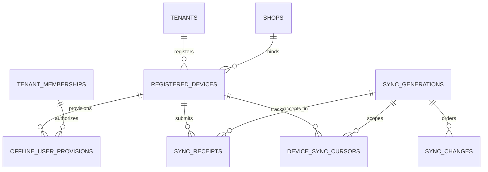

# DawaTrack Database / Schema Design

**Status:** Approved and frozen — authoritative database blueprint
**Version:** 1.1 — September 2026
**Target:** MySQL 8.4 LTS / InnoDB, CodeIgniter 4 and CodeIgniter Shield

---

## 1. Executive Technical Summary

This design translates the approved Business & Product Blueprint and Technical Blueprint into an implementation-ready relational model. MySQL is the canonical source of truth; IndexedDB is a durable client working store only. The design uses a shared database/shared schema, direct `tenant_id` ownership on important business rows, and `shop_id` on outlet operations. Phase 1 enforces one Shop per Tenant in the service layer while retaining a natural one-to-many database relationship.

The schema separates current state from immutable evidence and now treats full Shop white-labeling—including verified custom domains—as a Phase 1 capability:

* `stock_positions` is a lockable current-state projection; `stock_movements` is the accountable ledger.
* posted Sales, payments, Receivables, allocations, adjustments, Financial Movements and finalized Reconciliations are append-and-correct evidence;
* historical price/cost and Reconciliation observations are snapshots;
* customer balance, overdue state, gross-profit summaries and effective subscription access are derived;
* globally unique public/client identifiers let offline records form dependency graphs before server numeric IDs exist;
* durable Sync Receipts provide exactly-once business effects under at-least-once delivery, while a server change sequence provides pull cursors;
* Audit Events capture accountability and causal context without duplicating each transaction.
* Shop profile, branding, asset metadata and domain mappings are tenant-isolated mutable configuration synchronized for branded offline operation.

No reporting warehouse, general ledger, supplier, purchase-order, wallet, bank-reconciliation or multi-branch implementation is introduced.

### 1.1 v1.0 → v1.1 Refinement Summary

| Classification | Change and reason | Affected tables |
|---|---|---|
| Added | Full Phase 1 white-label profile, validated colours, asset metadata and verified platform/custom hostname mapping | `shops`, `shop_branding_profiles`, `shop_brand_assets`, `shop_domains` |
| Added | Append-only post-finalization variance explanations | `reconciliation_variance_notes` |
| Added/clarified | Scope-specific Cash/Stock predecessor periods and an explicit opening Cash control | `reconciliation_sessions`, `reconciliation_financial_counts` |
| Moved/renamed | Low-stock threshold moved to Shop/Product context; current quantity renamed to unambiguously mean system expectation | `products`, `stock_positions` |
| Removed/simplified | Removed `client_record_id`, UUIDv7/binary UUID conversion and sync resource versions; one UUIDv4 `public_id CHAR(36)` is permanent online/offline identity | all public resources, sync tables |
| Removed | Product normalized-name uniqueness; identical names are legitimate | `products` |
| Derived instead of persisted | Reversed state, variance adjustment completion and current Subscription status | posted evidence, `reconciliation_variances`, `subscriptions` |
| Clarified | Return header totals, Cash variance rollover, negative-to-positive WAC, status composition and sync receipt atomicity/offline lease limitations | Sales, Inventory, Reconciliation, Subscription, Offline/Sync |
| Removed from deferred scope | Verified custom domains are now mandatory Phase 1 white-label functionality | `shop_domains` and deferred-scope text |

### 1.2 Blueprint findings and resolved decisions

No blocking contradiction remains. This v1.1 instruction supersedes the earlier custom-domain deferral and resolves all prior open issues:

1. Phase 1 provides full white-label presentation, a platform subdomain and optional verified custom domains. Legal/support disclosures may identify DawaTrack, but routine Shop UX uses Shop branding.
2. Growth marketing mentions SMS reminder credits, while messaging is a future revenue feature. No messaging or credit-ledger tables are included.
3. “Receivable status” is described conceptually, but the Technical Blueprint says settlement state is derived. The schema therefore does not persist a mutable Receivable status; it derives outstanding/partial/settled and overdue from immutable amounts, allocations, adjustments and `due_date`.
4. Public/offline identity is one permanent browser/server-generated UUIDv4 stored as readable `CHAR(36)`; internal joins remain `BIGINT UNSIGNED`.
5. A Customer Return needs a durable commercial source. Rather than add an unrelated subsystem, `sales.kind = RETURN` and links to the original Sale/item model the return, refund, stock increase and Receivable adjustment together.
6. Reconciliation “financial counts” in Phase 1 are physical-cash counts only. Transfer activity contributes to reports/evidence but is not bank reconciliation.
7. The approved negative-stock cost reset, configurable retention, explicit opening Cash baseline and pinned Shield-schema decisions are final requirements, not open questions.

---

## 2. Design Principles and Constraints

1. **Canonical server:** only committed MySQL state is authoritative.
2. **Tenant isolation:** authorization establishes Tenant context; supplied IDs never authorize access. Child relationships must match `tenant_id` and, where relevant, `shop_id`.
3. **Explainable balances:** current Stock and cash expectations must be reconstructable from posted events and preserved baselines.
4. **Append and correct:** posted/finalized evidence is never silently edited or deleted. Reversal and replacement rows link causally.
5. **Atomic services:** every operation uses the owning CI4 business service, including synchronized operations.
6. **Offline identity:** UUIDs and operation IDs are generated before connectivity; retries retain identity.
7. **Concurrency over convenience:** lock current-state rows and Receivables before calculating changes.
8. **Phase 1 restraint:** one Shop per Tenant is enforced now, but core keys already include Shop where operationally correct.
9. **No generic polymorphic integrity:** important ledger sources use explicit nullable foreign keys plus a controlled source type and service/`CHECK` invariants.
10. **UTC and fixed precision:** no floating-point money, quantity or cost; server order is authoritative.
11. **White-label by configuration:** ordinary Shop surfaces resolve audited Shop branding/assets/domain data dynamically and cache it offline; legal disclosure remains intentional and hostname remains context, never authority.

---

## 3. Database Conventions

### 3.1 Naming and identifiers

* Tables and columns use lower `snake_case`, plural table names, and singular `<entity>_id` foreign keys.
* Each application table has `id BIGINT UNSIGNED AUTO_INCREMENT` as clustered PK. It stays internal and is never authorization evidence.
* Every externally/offline-addressable resource has one `public_id CHAR(36) CHARACTER SET ascii COLLATE ascii_bin`, a canonical lowercase UUIDv4 with `UNIQUE(public_id)`. A server creates it for online records; `crypto.randomUUID()` creates it offline. The exact submitted UUID becomes permanent when accepted.
* Offline dependencies use those permanent public IDs before numeric server IDs exist. There is no separate client-record identity.
* Sync `operation_id`, Device `device_uuid`, generation `generation_uuid` and workflow `correlation_id` are separate UUIDv4 values using the same `CHAR(36)` representation. Cryptographic hashes remain binary.
* An optional `idempotency_key VARCHAR(128)` supports non-sync online callers and is scoped to Tenant and operation family.
* Every FK column uses the exact signedness/type of its parent.

UUID format is validated by the service and a MySQL `CHECK`; values are normalized to lowercase before insertion. BIGINT clustered PKs provide relational index locality, so no UUIDv7 browser dependency or UUID binary conversion is justified.

### 3.2 Numeric precision and rounding

| Concept | Type | Rule |
|---|---|---|
| Naira transaction amount/price | `DECIMAL(19,2)` | non-negative unless a specifically signed effect column |
| Unit/acquisition/average cost | `DECIMAL(19,6)` | retain sub-kobo precision for weighted averages |
| Quantity | `DECIMAL(19,4)` | supports divisible base units; never `FLOAT` |
| Extended cost/profit snapshot | `DECIMAL(19,2)` | round half-up to kobo when posting |
| Ratio/average calculation | `DECIMAL(38,12)` intermediate | round stored average to 6 decimals only after calculation |

Sale line amount is `ROUND(quantity * unit_price, 2)`. COGS is `ROUND(quantity * unit_cost_snapshot, 2)`. Header totals equal the sum of posted lines. The service explicitly allocates any rounding remainder; MySQL session SQL mode must be strict. Currency is fixed to `NGN CHAR(3)` in Phase 1 where stored, not implied in exported evidence.

### 3.3 Time

* `DATETIME(6)` stores UTC. Application and DB sessions use `+00:00`; presentation converts using `shops.timezone_name` (initially `Africa/Lagos`).
* `created_at` is server insertion time; `updated_at` is server mutation time for mutable/draft rows; `posted_at`, `finalized_at` and `server_accepted_at` are authoritative server instants.
* `occurred_at` is the claimed business occurrence instant (UTC) and `device_local_offset_minutes SMALLINT NULL` preserves the device offset. It never establishes ordering, entitlement or cutoff eligibility.
* Calendar `DATE` is used for due dates and subscription period boundaries only where business-day semantics are intended. Subscription entitlements use half-open UTC intervals `[starts_at, ends_at)`.

### 3.4 Controlled values

Use `VARCHAR` columns constrained by application constants and, where migration portability permits, matching MySQL `CHECK` constraints. Do not use MySQL `ENUM`: adding values otherwise requires table DDL and couples deployments. Reference tables are reserved for admin-editable data; Phase 1 has none beyond Subscription Plans.

### 3.5 Common rules

* All tables are InnoDB with `utf8mb4`/`utf8mb4_0900_ai_ci`; UUIDs and normalized hostnames use explicit ASCII collations documented in migrations.
* `created_by_user_id`/actor FKs normally use `RESTRICT`; identity is deactivated, not deleted.
* JSON columns hold bounded metadata/snapshots only, are schema-versioned by the service, and never replace relational keys or searchable balances.
* Booleans are `BOOLEAN` (`TINYINT(1)`) with `NOT NULL` defaults and `CHECK (x IN (0,1))`.

---

## 4. Tenant Ownership Model

| Classification | Tables |
|---|---|
| Platform-level | Shield authentication tables, `subscription_plans`, `sync_generations` |
| Tenant-owned master/access | `tenants`, `tenant_memberships`, `membership_permission_grants`, `products`, `customers`, `subscriptions`, `subscription_events` |
| Shop operational | `stock_positions`, `stock_intakes`, `stock_intake_items`, `stock_movements`, `sales`, `sale_items`, `sale_payments`, `receivables`, `debt_payments`, `debt_payment_allocations`, `receivable_adjustments`, `financial_movements`, all Reconciliation tables |
| Shop configuration/cross-cutting | `shops`, `shop_branding_profiles`, `shop_brand_assets`, `shop_domains`, `registered_devices`, `offline_user_provisions`, `sync_receipts`, `sync_changes`, `device_sync_cursors`, `audit_events` |

Every critical operational table carries both `tenant_id` and `shop_id`; dependent rows repeat them deliberately for isolation, index locality and incident review. Migrations create composite parent uniques such as `UNIQUE(tenant_id, id)` and, where necessary, `UNIQUE(tenant_id, shop_id, id)`, allowing composite foreign keys to prove same-Tenant/same-Shop relationships. The service must also set scope from the authenticated membership rather than request payload.

Phase 1’s exactly-one-Shop rule is service-enforced during serialized onboarding and guarded by a feature/config invariant. A database `UNIQUE(tenant_id)` on `shops` is intentionally **not** used because removing it would be a schema redesign for multi-branch. Automated integrity checks alert if Phase 1 data violates the invariant.

---

## 5. Identity & Access Schema

### 5.1 CodeIgniter Shield-owned tables

Install the migration set shipped with the pinned latest stable Shield release rather than copying table definitions into DawaTrack migrations. Shield owns `users`, authentication identities/secrets, login/session/token infrastructure and its platform authorization structures. DawaTrack references `users.id` only. Ordinary users use username/password/server sessions; platform administrators use Shield’s platform group/permissions and mandatory second factor.

Shield answers **who** a person is. `tenant_memberships` answers **which Tenant** they belong to. `membership_permission_grants` answers **what Tenant operation** Staff may perform. A Platform Admin has a Shield platform role and no synthetic membership in every Tenant.

### 5.2 `tenant_memberships`

Purpose: durable association and authority state between a Shield user and Tenant. Tenant-owned Identity module. Owner/Staff history is retained.

| Column | Type | Null/default | Meaning/constraint |
|---|---|---|---|
| `id` | `BIGINT UNSIGNED` | PK, auto | internal identity |
| `public_id` | `CHAR(36)` ASCII | not null | permanent UUIDv4 |
| `tenant_id` | `BIGINT UNSIGNED` | not null | owning Tenant |
| `user_id` | Shield key type | not null | authenticated identity |
| `role` | `VARCHAR(24)` | not null | `PRIMARY_OWNER` or `STAFF` |
| `status` | `VARCHAR(16)` | `'ACTIVE'` | `INVITED`, `ACTIVE`, `DEACTIVATED` |
| `activated_at`, `deactivated_at` | `DATETIME(6)` | null | lifecycle evidence |
| `created_by_user_id` | Shield key type | not null | admin/owner creator |
| `created_at`, `updated_at` | `DATETIME(6)` | not null | server timestamps |

Keys/indexes: `UNIQUE(public_id)`, `UNIQUE(tenant_id,user_id)`, index `(user_id,status)`, `(tenant_id,status,role)`. A generated nullable `primary_owner_guard` may hold `tenant_id` only for active Primary Owner rows and be uniquely indexed, or the service must serialize owner reassignment; because MySQL lacks partial indexes, the generated-column solution is recommended. Phase 1 also transactionally prevents more than one active ordinary membership per user. Deactivate; never soft/hard delete after activity.

### 5.3 `membership_permission_grants`

Purpose: deny-by-default explicit Staff grants. Tenant-owned Identity module.

| Column | Type | Null/default | Meaning/constraint |
|---|---|---|---|
| `id` | `BIGINT UNSIGNED` | PK, auto | identity |
| `tenant_id`, `membership_id` | `BIGINT UNSIGNED` | not null | same-Tenant membership |
| `permission_code` | `VARCHAR(80)` | not null | versioned application constant |
| `granted_by_user_id` | Shield key type | not null | responsible Owner |
| `granted_at` | `DATETIME(6)` | not null | effective grant time |
| `revoked_by_user_id` | Shield key type | null | revoker |
| `revoked_at` | `DATETIME(6)` | null | null means active |
| `created_at` | `DATETIME(6)` | not null | insert time |

Keys/indexes: `UNIQUE(membership_id,permission_code,granted_at)`, `(tenant_id,membership_id,revoked_at)`. Composite FK `(tenant_id,membership_id)`; user FKs RESTRICT. Revocation updates lifecycle fields and emits Audit; rows are never deleted. Owners receive full normal Tenant authority by role in service policy, not thousands of grants. Sensitive reversal permissions remain distinct.

---

## 6. Tenant & Shop Schema

### 6.1 `tenants`

Purpose: subscribing business/customer identity and operational lifecycle. Tenant & Shop module.

| Column | Type | Null/default | Meaning/constraint |
|---|---|---|---|
| `id` | `BIGINT UNSIGNED` | PK, auto | internal Tenant key |
| `public_id` | `CHAR(36)` | not null | API identity |
| `legal_or_business_name` | `VARCHAR(160)` | not null | business name |
| `status` | `VARCHAR(16)` | `'ONBOARDING'` | operational status |
| `activated_at`, `suspended_at`, `closed_at` | `DATETIME(6)` | null | lifecycle instants |
| `status_reason` | `VARCHAR(500)` | null | required for suspend/close |
| `retention_until` | `DATE` | null | policy-controlled retained state |
| `created_by_user_id` | Shield key type | not null | Platform Admin |
| `created_at`, `updated_at` | `DATETIME(6)` | not null | timestamps |

Keys/indexes: `UNIQUE(public_id)`, `(status,created_at)`. Status transitions are audited. Closed is retained/no normal access, not deletion.

### 6.2 `shops`

Purpose: operational outlet and presentation/local-time configuration. Tenant-owned; operational root.

| Column | Type | Null/default | Meaning/constraint |
|---|---|---|---|
| `id` | `BIGINT UNSIGNED` | PK, auto | Shop key |
| `public_id` | `CHAR(36)` | not null | external identity |
| `tenant_id` | `BIGINT UNSIGNED` | not null | owner |
| `name` | `VARCHAR(160)` | not null | display name |
| `contact_phone` | `VARCHAR(32)` | null | normalized operational contact |
| `contact_email` | `VARCHAR(254)` | null | normalized contact email |
| `address_line_1`, `address_line_2` | `VARCHAR(180)` | first not null, second null | physical address |
| `city_town` | `VARCHAR(100)` | not null | locality |
| `state_region` | `VARCHAR(100)` | not null | state/region |
| `country_code` | `CHAR(2)` | `'NG'` | ISO 3166-1 alpha-2 |
| `timezone_name` | `VARCHAR(64)` | `'Africa/Lagos'` | IANA time zone |
| `currency_code` | `CHAR(3)` | `'NGN'` | Phase 1 currency |
| `status` | `VARCHAR(16)` | `'ACTIVE'` | `ACTIVE`, `INACTIVE` |
| `activated_at`, `deactivated_at` | `DATETIME(6)` | null | lifecycle |
| `created_at`, `updated_at` | `DATETIME(6)` | not null | timestamps |

Keys/indexes: `UNIQUE(public_id)`, `UNIQUE(tenant_id,id)`, `(tenant_id,status)`, `(tenant_id,name)`. Tenant FK RESTRICT. The Shop is the public/operational identity; Tenant legal name is not duplicated. Tenant status governs the subscribing account; Shop status governs this outlet. Effective operation requires Tenant `ACTIVE`, Shop `ACTIVE` and valid entitlement. In Phase 1 the two statuses are coordinated but remain distinct, not competing access flags.

### 6.3 `shop_branding_profiles`

Purpose: one mutable white-label presentation profile per Shop, synchronized for online/offline rendering.

| Column | Type | Null/default | Meaning/constraint |
|---|---|---|---|
| `id`, `public_id` | bigint/UUID | PK/not null | internal/permanent identities |
| `tenant_id`, `shop_id` | `BIGINT UNSIGNED` | not null | same-scope owner |
| `brand_display_name` | `VARCHAR(160)` | not null | primary user-facing brand |
| `tagline` | `VARCHAR(180)` | null | motto/tagline |
| `public_description` | `VARCHAR(500)` | null | bounded public copy |
| `primary_colour`, `secondary_colour`, `accent_colour` | `CHAR(7)` ASCII | not null | uppercase/lowercase-normalized `#RRGGBB` |
| `theme_colour`, `background_colour` | `CHAR(7)` ASCII | not null | PWA theme/splash colours |
| `pwa_full_name` | `VARCHAR(80)` | not null | manifest full name |
| `pwa_short_name` | `VARCHAR(24)` | not null | manifest/install short name |
| `application_title` | `VARCHAR(100)` | not null | browser/application title |
| `configuration_version` | `BIGINT UNSIGNED` | `1` | increments per audited edit/cache invalidation |
| `updated_by_user_id`, `created_at`, `updated_at` | user/time | not null | responsibility/lifecycle |

Keys/indexes: `UNIQUE(public_id)`, `UNIQUE(tenant_id,shop_id)`, `UNIQUE(tenant_id,shop_id,id)`. A `CHECK` enforces `^#[0-9A-Fa-f]{6}$`; services validate accessible colour combinations and manifest lengths. Important before/after deltas are audited. This mutable configuration is not transaction evidence.

### 6.4 `shop_brand_assets`

Purpose: metadata/versioned storage references for Shop-owned visual assets; MySQL never stores image bytes.

| Column | Type | Null/default | Meaning/constraint |
|---|---|---|---|
| `id`, `public_id`, `tenant_id`, `shop_id` | IDs | not null | identity/scope |
| `asset_type` | `VARCHAR(24)` | not null | `LOGO`, `FAVICON`, `PWA_ICON_192`, `PWA_ICON_512`, `LOGIN_BACKGROUND` |
| `storage_key` | `VARCHAR(500)` | not null | opaque safe object/path key, never a secret URL |
| `mime_type` | `VARCHAR(80)` | not null | allow-listed image MIME type |
| `width_px`, `height_px` | `SMALLINT UNSIGNED` | not null | verified decoded dimensions |
| `file_size_bytes` | `BIGINT UNSIGNED` | not null | validated size |
| `content_sha256` | `BINARY(32)` | not null | content integrity/cache version |
| `is_active` | `BOOLEAN` | `1` | current asset of this type |
| `uploaded_by_user_id`, `activated_at`, `deactivated_at`, `created_at` | mixed | deactivation null | provenance/lifecycle |

Keys/indexes: `UNIQUE(public_id)`, `UNIQUE(storage_key)`, `(tenant_id,shop_id,asset_type,is_active)`, `UNIQUE(tenant_id,shop_id,id)`. A generated nullable active-type guard uniquely enforces one active asset per Shop/type. Replacing an asset inserts a new version and deactivates the prior metadata atomically; historical metadata may be retained under policy. PWA icon types require exact stated dimensions. Storage, scanning, image processing and delivery are Infrastructure concerns.

### 6.5 `shop_domains`

Purpose: globally unique normalized hostname-to-Shop context mapping for platform subdomains and verified custom domains.

| Column | Type | Null/default | Meaning/constraint |
|---|---|---|---|
| `id`, `public_id`, `tenant_id`, `shop_id` | IDs | not null | identity/scope |
| `hostname` | `VARCHAR(253)` ASCII | not null | lowercase normalized hostname, no scheme/path/port |
| `domain_type` | `VARCHAR(24)` | not null | `PLATFORM_SUBDOMAIN`, `CUSTOM` |
| `verification_status` | `VARCHAR(16)` | `'PENDING'` | `PENDING`, `VERIFIED`, `FAILED` |
| `is_active`, `is_primary` | `BOOLEAN` | `0` | active routing/current canonical domain |
| `verification_method` | `VARCHAR(16)` | null | `DNS_TXT`, `DNS_CNAME`, `PLATFORM` |
| `verification_token_hash` | `BINARY(32)` | null | hashed challenge; no secret/certificate key |
| `verification_reference` | `VARCHAR(200)` | null | non-secret provider/provisioning reference |
| `certificate_status` | `VARCHAR(16)` | null | `PENDING`, `ACTIVE`, `FAILED`; operational only |
| `verified_at`, `activated_at`, `deactivated_at` | `DATETIME(6)` | null | lifecycle evidence |
| `created_by_admin_user_id`, `verified_by_admin_user_id`, `updated_by_user_id` | Shield key type | appropriate nullability | Platform Admin provenance |
| `created_at`, `updated_at` | `DATETIME(6)` | not null | timestamps |

Keys/indexes: `UNIQUE(hostname)`, `UNIQUE(public_id)`, `(tenant_id,shop_id,is_active,is_primary)`, `UNIQUE(tenant_id,shop_id,id)`. Generated nullable guards enforce at most one active primary domain per Shop. Platform subdomain verification is platform-controlled; a Custom domain cannot activate or become primary until verified. Primary switching never changes `shop_id`. Domain changes are audited and emit sync changes. Hostname selects context only; authentication, membership, permission, Tenant/Shop state and entitlement still authorize every request. TLS private keys/certificate secrets are never stored.

---

## 7. Product Catalog Schema

### 7.1 `products`

Purpose: Tenant-level product master with one base stock/sale unit. Product Catalog module.

| Column | Type | Null/default | Meaning/constraint |
|---|---|---|---|
| `id` | `BIGINT UNSIGNED` | PK, auto | key |
| `public_id` | `CHAR(36)` ASCII | not null | permanent UUIDv4 |
| `tenant_id` | `BIGINT UNSIGNED` | not null | owner |
| `name` | `VARCHAR(180)` | not null | current name |
| `normalized_name` | `VARCHAR(180)` | not null | application-normalized search/warning value |
| `unit_name` | `VARCHAR(40)` | not null | single base unit, e.g. tablet/bottle |
| `current_selling_price` | `DECIMAL(19,2)` | not null | current default, `>=0` |
| `status` | `VARCHAR(16)` | `'ACTIVE'` | `ACTIVE`, `INACTIVE` |
| `created_by_user_id` | Shield key type | not null | creator |
| `created_at`, `updated_at`, `deactivated_at` | `DATETIME(6)` | last null | lifecycle |

Keys/indexes: `UNIQUE(public_id)`, non-unique `(tenant_id,normalized_name)`, `(tenant_id,status,name)`, `UNIQUE(tenant_id,id)`. Identical display/normalized names are valid; UI may warn but never merge/reject them. Price is mutable and audited; Sale Items snapshot it. No barcode, mandatory product code, supplier or package-conversion fields. Deactivate; historical FKs RESTRICT deletion.

---

## 8. Inventory Schema

### 8.1 `stock_positions`

Purpose: lockable current expected quantity and current moving-average cost. Shop operational current state.

| Column | Type | Null/default | Meaning/constraint |
|---|---|---|---|
| `id` | `BIGINT UNSIGNED` | PK, auto | key |
| `tenant_id`, `shop_id`, `product_id` | `BIGINT UNSIGNED` | not null | isolated position identity |
| `expected_quantity` | `DECIMAL(19,4)` | `0` | may be negative |
| `low_stock_threshold` | `DECIMAL(19,4)` | `0` | Shop/Product alert threshold, `>=0` |
| `average_unit_cost` | `DECIMAL(19,6)` | `0` | retained last valid basis, `>=0` |
| `cost_basis_state` | `VARCHAR(16)` | `'UNESTABLISHED'` | `UNESTABLISHED`, `VALID`, `RETAINED` |
| `last_movement_id` | `BIGINT UNSIGNED` | null | last applied ledger row |
| `version` | `BIGINT UNSIGNED` | `0` | optimistic diagnostics; increments each write |
| `created_at`, `updated_at` | `DATETIME(6)` | not null | timestamps |

Keys/indexes: `UNIQUE(tenant_id,shop_id,product_id)`, `(tenant_id,shop_id,expected_quantity)`. Composite FKs prove Shop/Product Tenant ownership. Low stock is derived as `expected_quantity <= low_stock_threshold`; the threshold may be edited/audited without a movement. Quantity/cost have no manual update endpoint and every mutation occurs with a Stock Movement in the same transaction under `SELECT ... FOR UPDATE`.

### 8.2 `stock_intakes`

Purpose: header for Opening Stock or later intake, with Draft → Posted lifecycle. Shop operational Inventory module.

| Column | Type | Null/default | Meaning/constraint |
|---|---|---|---|
| `id`, `public_id` | bigint/UUID | PK/not null | internal/permanent identities |
| `tenant_id`, `shop_id` | `BIGINT UNSIGNED` | not null | scope |
| `intake_kind` | `VARCHAR(16)` | not null | `OPENING`, `RECEIPT` |
| `status` | `VARCHAR(16)` | `'DRAFT'` | authoritative transition is only `DRAFT` → `POSTED` |
| `reference` | `VARCHAR(100)` | null | receipt/manual reference, not Supplier entity |
| `notes` | `VARCHAR(1000)` | null | bounded note |
| `occurred_at`, `device_local_offset_minutes` | datetime/smallint | offset null | business context |
| `posted_at`, `posted_by_user_id` | datetime/user FK | null | authoritative posting |
| `reversal_of_intake_id`, `replacement_for_intake_id` | `BIGINT UNSIGNED` | null | traceable correction |
| `correlation_id` | `CHAR(36)` | null | workflow |
| `created_by_user_id`, `created_at`, `updated_at` | user/time | not null | provenance |

Keys/indexes: unique public IDs; `(tenant_id,shop_id,status,occurred_at)`, `(tenant_id,shop_id,posted_at)`, unique nullable reversal/replacement link where one-to-one is required. A posted row never changes to `REVERSED`; effective reversal is derived from a new linked Intake and compensating movements.

### 8.3 `stock_intake_items`

Purpose: immutable posted quantities and acquisition costs.

| Column | Type | Null/default | Meaning/constraint |
|---|---|---|---|
| `id`, `public_id` | bigint/UUID | PK/not null | identities |
| `tenant_id`, `shop_id`, `stock_intake_id`, `product_id` | `BIGINT UNSIGNED` | not null | scoped parents |
| `quantity` | `DECIMAL(19,4)` | not null | `>0` |
| `unit_cost` | `DECIMAL(19,6)` | not null | `>=0` |
| `line_cost_amount` | `DECIMAL(19,2)` | not null | posted rounded snapshot |
| `line_number` | `SMALLINT UNSIGNED` | not null | display order |
| `created_at`, `updated_at` | `DATETIME(6)` | not null | draft timestamps |

Keys/indexes: `UNIQUE(stock_intake_id,line_number)`, `(tenant_id,shop_id,product_id,stock_intake_id)`, `UNIQUE(tenant_id,shop_id,id)`. Header/item totals validated on post. Editable only while header Draft.

### 8.4 `stock_movements`

Purpose: immutable movement ledger; every accountable change is one row. Shop operational Inventory module.

| Column | Type | Null/default | Meaning/constraint |
|---|---|---|---|
| `id`, `public_id` | bigint/UUID | PK/not null | identities |
| `tenant_id`, `shop_id`, `product_id`, `stock_position_id` | `BIGINT UNSIGNED` | not null | scoped stock identity |
| `movement_type` | `VARCHAR(32)` | not null | controlled catalogue |
| `quantity_delta` | `DECIMAL(19,4)` | not null | signed, non-zero |
| `unit_cost_basis` | `DECIMAL(19,6)` | not null | cost applied/snapshot, `>=0` |
| `quantity_before`, `quantity_after` | `DECIMAL(19,4)` | not null | application snapshots |
| `average_cost_before`, `average_cost_after` | `DECIMAL(19,6)` | not null | costing evidence |
| `source_kind` | `VARCHAR(32)` | not null | `INTAKE_ITEM`, `SALE_ITEM`, `RECON_VARIANCE`, `MANUAL`, `REVERSAL` |
| `stock_intake_item_id`, `sale_item_id`, `reconciliation_variance_id` | `BIGINT UNSIGNED` | null | explicit source FKs |
| `reversal_of_movement_id` | `BIGINT UNSIGNED` | null | compensates original |
| `reason_code` | `VARCHAR(40)` | null | required for manual/loss/correction |
| `reason_text` | `VARCHAR(500)` | null | required sensitive explanation |
| `occurred_at`, `posted_at` | `DATETIME(6)` | not null | contextual/server times |
| `created_by_user_id`, `correlation_id`, `created_at` | user/UUID/time | not null except correlation | provenance |

Keys/indexes: `UNIQUE(public_id)`, `UNIQUE(reversal_of_movement_id)` for single direct reversal, `(tenant_id,shop_id,product_id,posted_at,id)`, `(tenant_id,shop_id,movement_type,posted_at)`, indexes on each non-null source FK. A `CHECK`/service invariant requires exactly the source FK appropriate to `source_kind`; it also enforces sign/type compatibility. The explicit FK approach preserves relational integrity and avoids `(source_type, source_id)` polymorphism. Rows are insert-only.

### 8.5 Moving weighted average behavior

Opening/receipt intake while existing quantity is positive applies the approved formula. Normal outgoing movements snapshot current average and do not change it. If quantity is zero/negative, outgoing movements use and retain the last valid basis (`RETAINED`); negative quantity and value are excluded from WAC arithmetic. An incoming Intake that leaves expected quantity at or below zero retains that basis. The first incoming Intake that restores expected quantity above zero resets `average_unit_cost` to that Intake's unit cost for the newly positive position and sets the basis `VALID`. The movement snapshots the transition. Historical Sale Item costs never change.

---

## 9. Sales & Payment Schema

### 9.1 `sales`

Purpose: commercial Sale/Return header and protected lifecycle. Shop operational Sales module.

| Column | Type | Null/default | Meaning/constraint |
|---|---|---|---|
| `id`, `public_id` | bigint/UUID | PK/not null | internal/permanent identities |
| `tenant_id`, `shop_id` | `BIGINT UNSIGNED` | not null | scope |
| `kind` | `VARCHAR(16)` | `'SALE'` | `SALE`, `RETURN` |
| `status` | `VARCHAR(16)` | `'DRAFT'` | authoritative transition is only `DRAFT` → `POSTED` |
| `customer_id` | `BIGINT UNSIGNED` | null | mandatory if credit; return normally inherits original |
| `original_sale_id` | `BIGINT UNSIGNED` | null | required for Return |
| `subtotal_amount`, `total_amount` | `DECIMAL(19,2)` | `0` | non-negative posted snapshots |
| `received_amount_snapshot`, `credit_created_amount_snapshot` | `DECIMAL(19,2)` | null | required only for `SALE`; sum equals total |
| `currency_code` | `CHAR(3)` | `'NGN'` | evidence |
| `occurred_at`, `device_local_offset_minutes` | datetime/smallint | offset null | business context |
| `posted_at`, `posted_by_user_id` | datetime/user | null | server authority |
| `reversal_of_sale_id`, `replacement_for_sale_id` | `BIGINT UNSIGNED` | null | correction chain |
| `correlation_id`, `created_by_user_id`, `created_at`, `updated_at` | mixed | correlation null | provenance |

Keys/indexes: unique public IDs, `(tenant_id,shop_id,posted_at,id)`, `(tenant_id,shop_id,posted_by_user_id,posted_at)`, `(tenant_id,customer_id,posted_at)`, indexes on original/reversal links. For `SALE`, received snapshot equals Receipt payments, credit snapshot equals its Receivable and their sum equals commercial total. For `RETURN`, both fields must be NULL: refunds are `sale_payments.direction=REFUND`, debt reductions are `receivable_adjustments`, and their sum equals the Return total. Credit requires Customer and exactly one Receivable. Drafts may be discarded; posted contents never change and reversal state is derived from a linked compensating Sale.

### 9.2 `sale_items`

Purpose: price and cost snapshot lines.

| Column | Type | Null/default | Meaning/constraint |
|---|---|---|---|
| `id`, `public_id` | bigint/UUID | PK/not null | identities |
| `tenant_id`, `shop_id`, `sale_id`, `product_id` | `BIGINT UNSIGNED` | not null | scoped relationships |
| `original_sale_item_id` | `BIGINT UNSIGNED` | null | required on Return line; same Product |
| `line_number` | `SMALLINT UNSIGNED` | not null | ordering |
| `quantity` | `DECIMAL(19,4)` | not null | positive magnitude |
| `unit_selling_price` | `DECIMAL(19,2)` | not null | historical price |
| `line_sales_amount` | `DECIMAL(19,2)` | not null | rounded snapshot |
| `unit_cost_snapshot` | `DECIMAL(19,6)` | not null | moving-average basis at posting |
| `line_cogs_amount` | `DECIMAL(19,2)` | not null | historical COGS magnitude |
| `created_at`, `updated_at` | `DATETIME(6)` | not null | draft timestamps |

Keys/indexes: `UNIQUE(sale_id,line_number)`, `UNIQUE(tenant_id,shop_id,id)`, `(tenant_id,shop_id,product_id,sale_id)`, index original line. Return quantity across effective posted Returns, after linked compensations, may not exceed original net quantity; service locks original Sale/items. Gross profit uses signed Sale/Return effects from snapshots.

### 9.3 `sale_payments`

Purpose: actual funds received/refunded for a Sale; Credit never appears here.

| Column | Type | Null/default | Meaning/constraint |
|---|---|---|---|
| `id`, `public_id` | bigint/UUID | PK/not null | internal/permanent identities |
| `tenant_id`, `shop_id`, `sale_id` | `BIGINT UNSIGNED` | not null | scoped Sale |
| `direction` | `VARCHAR(12)` | `'RECEIPT'` | `RECEIPT`, `REFUND` |
| `channel` | `VARCHAR(12)` | not null | `CASH`, `TRANSFER` |
| `amount` | `DECIMAL(19,2)` | not null | `>0` magnitude |
| `external_reference` | `VARCHAR(120)` | null | transfer reference |
| `occurred_at`, `posted_at`, `created_by_user_id` | time/time/user | not null | evidence |
| `reversal_of_payment_id` | `BIGINT UNSIGNED` | null | compensating payment |
| `correlation_id`, `created_at` | UUID/time | correlation null | provenance |

Keys/indexes: unique public IDs, `UNIQUE(reversal_of_payment_id)`, `(tenant_id,shop_id,channel,posted_at)`, `(tenant_id,sale_id)`. Payment sums are transactionally validated against Sale/Return amounts. Rows are posted/insert-only; reversal state is derived from the linked compensating payment.

---

## 10. Customer & Debt Schema

### 10.1 `customers`

Purpose: Tenant Customer identity required for credit. Tenant-owned Customer & Debt module.

| Column | Type | Null/default | Meaning/constraint |
|---|---|---|---|
| `id`, `public_id` | bigint/UUID | PK/not null | internal/permanent identities |
| `tenant_id` | `BIGINT UNSIGNED` | not null | owner |
| `display_name` | `VARCHAR(160)` | not null | name |
| `phone` | `VARCHAR(32)` | null | normalized by service |
| `notes` | `VARCHAR(500)` | null | minimal relevant notes |
| `status` | `VARCHAR(16)` | `'ACTIVE'` | `ACTIVE`, `INACTIVE` |
| `created_by_user_id`, `created_at`, `updated_at`, `deactivated_at` | mixed | last null | lifecycle |

Keys/indexes: unique public IDs, `(tenant_id,status,display_name)`, `(tenant_id,phone)`, `UNIQUE(tenant_id,id)`. Do not force phone uniqueness because shared/missing numbers are legitimate. Balance is not stored. Deactivate, never erase history.

### 10.2 `receivables`

Purpose: one Sale-linked unpaid credit obligation.

| Column | Type | Null/default | Meaning/constraint |
|---|---|---|---|
| `id`, `public_id` | IDs | PK/not null | identity |
| `tenant_id`, `shop_id`, `customer_id`, `sale_id` | `BIGINT UNSIGNED` | not null | same-scope source |
| `original_amount` | `DECIMAL(19,2)` | not null | `>0`, equals Sale credit portion |
| `due_date` | `DATE` | null | optional local business date |
| `occurred_at`, `posted_at` | `DATETIME(6)` | not null | evidence |
| `created_by_user_id`, `created_at` | user/time | not null | provenance |

Keys/indexes: `UNIQUE(sale_id)`, `UNIQUE(public_id)`, `UNIQUE(tenant_id,shop_id,id)`, `(tenant_id,shop_id,customer_id,posted_at,id)`, `(tenant_id,shop_id,due_date)`. Outstanding is `original_amount + effective signed adjustments - effective allocations` after linked compensations, never a manually editable column. No interest fields and no deletion.

### 10.3 `debt_payments`

Purpose: independent Customer collection event, potentially allocated across debts.

| Column | Type | Null/default | Meaning/constraint |
|---|---|---|---|
| `id`, `public_id` | bigint/UUID | PK/not null | internal/permanent identities |
| `tenant_id`, `shop_id`, `customer_id` | `BIGINT UNSIGNED` | not null | scope |
| `channel` | `VARCHAR(12)` | not null | `CASH`, `TRANSFER` |
| `amount` | `DECIMAL(19,2)` | not null | `>0` |
| `external_reference` | `VARCHAR(120)` | null | transfer reference |
| `occurred_at`, `posted_at`, `created_by_user_id` | mixed | not null | evidence |
| `reversal_of_debt_payment_id` | `BIGINT UNSIGNED` | null | linked reversal |
| `correlation_id`, `created_at` | UUID/time | correlation null | provenance |

Keys/indexes: unique public IDs, unique reversal link, `(tenant_id,shop_id,customer_id,posted_at)`, `(tenant_id,shop_id,channel,posted_at)`. The allocation total must equal amount for a posted payment; there is no unallocated wallet balance. Reversal state is derived from a linked compensating Debt Payment; the original and its allocations never mutate.

### 10.4 `debt_payment_allocations`

Purpose: many-to-many trace between collection and Receivables.

| Column | Type | Null/default | Meaning/constraint |
|---|---|---|---|
| `id` | `BIGINT UNSIGNED` | PK, auto | key |
| `tenant_id`, `shop_id`, `debt_payment_id`, `receivable_id` | `BIGINT UNSIGNED` | not null | same Customer/scope enforced by service |
| `amount` | `DECIMAL(19,2)` | not null | `>0` |
| `allocation_order` | `SMALLINT UNSIGNED` | not null | oldest-first/explicit order evidence |
| `created_at` | `DATETIME(6)` | not null | posting time |

Keys/indexes: `UNIQUE(debt_payment_id,receivable_id)`, `(tenant_id,shop_id,receivable_id)`, `(tenant_id,debt_payment_id,allocation_order)`. Rows share payment lifecycle; reversal is a new reversing Debt Payment with signed effect determined by its reversal link, not destructive allocation updates.

Over-allocation is prevented transactionally: lock the Customer’s candidate Receivable rows in stable `(posted_at,id)` order, recompute each outstanding balance and total debt, reject payment greater than total, insert allocations, then recheck allocation sums before commit. Unique Sync Receipt prevents retries. Optional nightly integrity queries detect `allocated > original + adjustments` and `sum(allocation) != payment.amount`; a plain `CHECK` cannot aggregate across rows.

### 10.5 `receivable_adjustments`

Purpose: legitimate non-payment changes, especially credit Return/correction.

| Column | Type | Null/default | Meaning/constraint |
|---|---|---|---|
| `id`, `public_id` | IDs | PK/not null | identity |
| `tenant_id`, `shop_id`, `receivable_id` | `BIGINT UNSIGNED` | not null | scope |
| `adjustment_type` | `VARCHAR(24)` | not null | `RETURN_REDUCTION`, `CORRECTION_INCREASE`, `CORRECTION_DECREASE`, `REVERSAL` |
| `amount_delta` | `DECIMAL(19,2)` | not null | signed non-zero effect on debt |
| `sale_id` | `BIGINT UNSIGNED` | null | Return/correction source where applicable |
| `reason` | `VARCHAR(500)` | not null | required justification |
| `reversal_of_adjustment_id` | `BIGINT UNSIGNED` | null | compensation |
| `occurred_at`, `posted_at`, `created_by_user_id`, `correlation_id`, `created_at` | mixed | correlation null | evidence |

Keys/indexes: `UNIQUE(public_id)`, unique reversal link, `(tenant_id,shop_id,receivable_id,posted_at)`, index Sale. Service locks Receivable and prevents a reduction below zero outstanding. Rows are insert-only and reversal state is derived from a linked compensating Adjustment. There is no generic write-off, interest or penalty type.

---

## 11. Financial Movement Schema

### 11.1 `financial_movements`

Purpose: posted, non-sale money movement—not a general ledger. Shop operational Financial Movement module.

| Column | Type | Null/default | Meaning/constraint |
|---|---|---|---|
| `id`, `public_id` | bigint/UUID | PK/not null | internal/permanent identities |
| `tenant_id`, `shop_id` | `BIGINT UNSIGNED` | not null | scope |
| `movement_type` | `VARCHAR(32)` | not null | controlled type |
| `channel` | `VARCHAR(12)` | not null | `CASH`, `TRANSFER` |
| `amount_delta` | `DECIMAL(19,2)` | not null | signed, non-zero cash/transfer effect |
| `description` | `VARCHAR(300)` | not null | business explanation |
| `external_reference` | `VARCHAR(120)` | null | transfer/reference |
| `reversal_of_movement_id`, `replacement_for_movement_id` | `BIGINT UNSIGNED` | null | correction chain |
| `occurred_at`, `posted_at`, `created_by_user_id`, `correlation_id`, `created_at` | mixed | correlation null | evidence |

Keys/indexes: unique public IDs, unique reversal link, `(tenant_id,shop_id,channel,posted_at,id)`, `(tenant_id,shop_id,movement_type,posted_at)`. Type/sign checks: Expense and Owner Withdrawal negative; Owner Introduction positive; Correction may be either but needs permission/reason. Corrections are new linked rows; originals are insert-only and reversal state is derived. A Cash variance never automatically creates a Financial Movement; a new movement represents a genuine event in the new control period.

---

## 12. Reconciliation Schema

### 12.1 `reconciliation_sessions`

Purpose: authoritative period, scope and lifecycle. Shop operational Reconciliation module.

| Column | Type | Null/default | Meaning/constraint |
|---|---|---|---|
| `id`, `public_id` | IDs | PK/not null | identity |
| `tenant_id`, `shop_id` | `BIGINT UNSIGNED` | not null | scope |
| `scope` | `VARCHAR(12)` | not null | `CASH`, `STOCK`, `FULL` |
| `control_kind` | `VARCHAR(12)` | `'STANDARD'` | `OPENING`, `STANDARD`; OPENING requires CASH scope |
| `status` | `VARCHAR(24)` | `'COUNTING'` | lifecycle |
| `cash_period_starts_at`, `stock_period_starts_at` | `DATETIME(6)` | null | separate scope beginnings; required only when included |
| `cutoff_at` | `DATETIME(6)` | not null | common fixed authoritative cutoff |
| `cutoff_change_sequence` | `BIGINT UNSIGNED` | not null | exact server change watermark |
| `sync_generation_id` | `BIGINT UNSIGNED` | not null | restore epoch |
| `started_by_user_id`, `started_at` | user/time | not null | start evidence |
| `counts_committed_by_user_id`, `counts_committed_at` | user/time | null | blind count commitment |
| `finalized_by_user_id`, `finalized_at` | user/time | null | final authority |
| `aborted_by_user_id`, `aborted_at`, `abort_reason` | mixed | null | retained abort evidence |
| `previous_cash_session_id`, `previous_stock_session_id` | `BIGINT UNSIGNED` | null | independent finalized scope control points |
| `notes`, `created_at`, `updated_at` | varchar/time | notes null | context |

Keys/indexes: `UNIQUE(public_id)`, `(tenant_id,shop_id,status,cutoff_at)`, `(tenant_id,shop_id,finalized_at)`, indexes on both predecessor FKs. Service permits at most one active overlapping session per Shop/scope under a Shop lock. A Full session may point to different previous Cash and Stock sessions and retain different period starts. Each predecessor must be finalized, same Shop and contain that scope. Expected snapshots are captured at cutoff, not queried live later.

`OPENING` is an explicit first Cash control: the Owner physically enters/confirms cash, expected and actual equal that entered baseline, all activity components are zero, both Cash period start and cutoff are the confirmation instant, and no previous Cash session exists. It is finalized and audited before any normal cash-affecting Sale, Debt Payment or Financial Movement is accepted. Owner Introduction is a subsequent real movement, never a baseline substitute.

### 12.2 `reconciliation_stock_counts`

Purpose: immutable expected/actual Product snapshot with blind-count commitment.

| Column | Type | Null/default | Meaning/constraint |
|---|---|---|---|
| `id`, `tenant_id`, `shop_id`, `reconciliation_session_id`, `product_id` | bigint | not null | scoped identity |
| `expected_quantity` | `DECIMAL(19,4)` | not null | snapshot at cutoff |
| `expected_average_unit_cost` | `DECIMAL(19,6)` | not null | valuation context |
| `actual_quantity` | `DECIMAL(19,4)` | null | physical count until committed |
| `variance_quantity` | `DECIMAL(19,4)` | null | persisted `actual - expected` |
| `counted_by_user_id`, `counted_at` | user/time | null | observer |
| `committed_at` | `DATETIME(6)` | null | line locked |
| `explanation` | `VARCHAR(500)` | null | does not erase variance |
| `created_at`, `updated_at` | `DATETIME(6)` | not null | lifecycle |

Keys/indexes: `UNIQUE(reconciliation_session_id,product_id)`, `(tenant_id,shop_id,product_id,reconciliation_session_id)`. Expected is hidden at API/UI until commitment. `CHECK` ensures variance equals actual minus expected where non-null; service recomputes. Finalization freezes all fields.

### 12.3 `reconciliation_financial_counts`

Purpose: physical-cash expectation and observation snapshot (one CASH row in Phase 1).

| Column | Type | Null/default | Meaning/constraint |
|---|---|---|---|
| `id`, `tenant_id`, `shop_id`, `reconciliation_session_id` | bigint | not null | scope |
| `channel` | `VARCHAR(12)` | `'CASH'` | CASH only in Phase 1 |
| `opening_baseline_amount` | `DECIMAL(19,2)` | not null | OPENING confirmed amount or prior Cash session actual |
| `cash_sale_receipts`, `cash_sale_refunds`, `cash_debt_receipts` | `DECIMAL(19,2)` | `0` | cutoff component snapshots |
| `cash_introductions`, `cash_expenses`, `cash_withdrawals`, `cash_corrections_net` | `DECIMAL(19,2)` | `0` | component snapshots |
| `expected_amount` | `DECIMAL(19,2)` | not null | frozen computed expectation |
| `actual_amount` | `DECIMAL(19,2)` | null | physical count |
| `variance_amount` | `DECIMAL(19,2)` | null | `actual - expected` |
| `counted_by_user_id`, `counted_at`, `committed_at` | mixed | null | count evidence |
| `explanation` | `VARCHAR(500)` | null | variance explanation |
| `created_at`, `updated_at` | time | not null | lifecycle |

Keys/indexes: `UNIQUE(reconciliation_session_id,channel)`, `(tenant_id,shop_id,reconciliation_session_id)`. Component identity makes expected cash reconstructable without a general ledger. `CHECK` formulae supplement service validation. Expected stays blind until count commitment except the explicit OPENING confirmation.

For every later Cash/Full session, the previous finalized Cash `actual_amount` is the new `opening_baseline_amount`, even when it contained a shortage/surplus. No automatic Financial Movement is generated for the variance, because that would double-adjust cash. A post-finalization discovery about an omitted pre-cutoff event is recorded as a variance note; only a genuinely new post-baseline cash event becomes a new Financial Movement.

### 12.4 `reconciliation_variances`

Purpose: normalized, linkable and fully immutable finalized variance evidence.

| Column | Type | Null/default | Meaning/constraint |
|---|---|---|---|
| `id`, `public_id`, `tenant_id`, `shop_id`, `reconciliation_session_id` | IDs | not null | identity/scope |
| `variance_kind` | `VARCHAR(12)` | not null | `STOCK`, `CASH` |
| `stock_count_id`, `financial_count_id` | `BIGINT UNSIGNED` | null | exactly one source |
| `quantity_variance` | `DECIMAL(19,4)` | null | Stock actual − expected |
| `amount_variance` | `DECIMAL(19,2)` | null | Cash actual − expected |
| `explanation` | `VARCHAR(500)` | null | reviewed reason |
| `created_at` | `DATETIME(6)` | not null | finalized evidence time |

Keys/indexes: unique public ID, unique stock-count and financial-count FKs, `(tenant_id,shop_id,reconciliation_session_id,variance_kind)`. Exactly-one source/value `CHECK`. A later Stock Reconciliation Adjustment Movement may reference a Stock variance. Adjustment presence/completion is derived from linked movements; no mutable state exists here. Cash variances are not adjusted by an automatic Financial Movement.

### 12.5 `reconciliation_variance_notes`

Purpose: append-only explanations, investigation findings and review notes added after finalized observations without mutating them.

| Column | Type | Null/default | Meaning/constraint |
|---|---|---|---|
| `id`, `public_id` | bigint/UUID | PK/not null | identities |
| `tenant_id`, `shop_id`, `reconciliation_session_id`, `reconciliation_variance_id` | `BIGINT UNSIGNED` | not null | same-scope finalized variance |
| `note_type` | `VARCHAR(24)` | not null | `EXPLANATION`, `INVESTIGATION_FINDING`, `REVIEW_NOTE` |
| `note_text` | `VARCHAR(2000)` | not null | evidence text |
| `created_by_user_id`, `created_at` | user/time | not null | responsible author/time |

Keys/indexes: `UNIQUE(public_id)`, `(tenant_id,shop_id,reconciliation_variance_id,created_at,id)`, `(reconciliation_session_id,created_at)`. Insert-only; correction uses a new note that references/explains the earlier note in text/Audit rather than updating/deleting it. Explanations entered before finalization remain frozen on the count/variance snapshot; later material uses this table.

### 12.6 `reconciliation_staff_contexts`

Purpose: on-duty/responsibility context without asserting guilt.

| Column | Type | Null/default | Meaning/constraint |
|---|---|---|---|
| `id`, `tenant_id`, `shop_id`, `reconciliation_session_id` | bigint | not null | scope |
| `membership_id`, `user_id` | appropriate IDs | not null | responsible historical identity |
| `context_role` | `VARCHAR(24)` | not null | `ON_DUTY`, `COUNTER`, `REVIEWER`, `FINALIZER` |
| `context_starts_at`, `context_ends_at` | `DATETIME(6)` | null | known duty window |
| `notes`, `created_at` | varchar/time | notes null | evidence |

Keys/indexes: `UNIQUE(reconciliation_session_id,membership_id,context_role)`, `(tenant_id,shop_id,user_id,reconciliation_session_id)`. Insert-only after finalization.

### 12.7 `reconciliation_device_acknowledgements`

Purpose: required supporting table proving active-device readiness or explicit exclusion at cutoff.

| Column | Type | Null/default | Meaning/constraint |
|---|---|---|---|
| `id`, `tenant_id`, `shop_id`, `reconciliation_session_id`, `registered_device_id` | bigint | not null | scope |
| `readiness_status` | `VARCHAR(16)` | not null | `ACKNOWLEDGED`, `EXCLUDED` |
| `acknowledged_change_sequence` | `BIGINT UNSIGNED` | null | device watermark |
| `reason` | `VARCHAR(500)` | null | mandatory for exclusion |
| `decided_by_user_id`, `decided_at`, `created_at` | mixed | not null | authority/evidence |

Keys/indexes: `UNIQUE(reconciliation_session_id,registered_device_id)`, `(tenant_id,shop_id,readiness_status)`. Finalization requires every relevant active device to be acknowledged or explicitly excluded. Late accepted operations are retained and flagged; they never mutate frozen evidence.

---

## 13. Subscription Schema

### 13.1 `subscription_plans`

Purpose: platform-controlled commercial plan definition; not per-Tenant.

| Column | Type | Null/default | Meaning/constraint |
|---|---|---|---|
| `id`, `public_id` | IDs | PK/not null | identity |
| `code` | `VARCHAR(24)` | not null | `TRIAL`, `STARTER`, `GROWTH` |
| `name` | `VARCHAR(80)` | not null | display |
| `max_active_staff` | `SMALLINT UNSIGNED` | not null | 5/2/5 respectively |
| `monthly_price_amount` | `DECIMAL(19,2)` | null | configured price; Trial zero |
| `currency_code` | `CHAR(3)` | `'NGN'` | price currency |
| `is_active` | `BOOLEAN` | `1` | selectable for new periods |
| `created_at`, `updated_at` | `DATETIME(6)` | not null | timestamps |

Keys/indexes: `UNIQUE(public_id)`, `UNIQUE(code)`, `(is_active,code)`. Historical Subscriptions snapshot key terms, so plan updates do not rewrite entitlements.

### 13.2 `subscriptions`

Purpose: one immutable entitlement period/plan decision; renewal/change creates another row.

| Column | Type | Null/default | Meaning/constraint |
|---|---|---|---|
| `id`, `public_id`, `tenant_id`, `subscription_plan_id` | IDs | not null | identity/scope |
| `entitlement_type` | `VARCHAR(12)` | not null | `TRIAL`, `PAID` immutable period kind |
| `starts_at`, `ends_at` | `DATETIME(6)` | not null | half-open period |
| `plan_code_snapshot` | `VARCHAR(24)` | not null | historical plan |
| `max_active_staff_snapshot` | `SMALLINT UNSIGNED` | not null | entitlement |
| `price_amount_snapshot` | `DECIMAL(19,2)` | not null | recorded commercial amount |
| `currency_code` | `CHAR(3)` | `'NGN'` | snapshot |
| `external_reference` | `VARCHAR(120)` | null | manual payment/reference |
| `supersedes_subscription_id` | `BIGINT UNSIGNED` | null | upgrade/downgrade chain |
| `created_by_user_id`, `reason`, `created_at` | mixed | reason null | Platform Admin evidence |

Keys/indexes: `UNIQUE(public_id)`, `(tenant_id,starts_at,ends_at)`, `(entitlement_type,ends_at)`, `UNIQUE(tenant_id,id)`. Service serializes changes, prevents invalid overlaps except an explicitly superseded immediate upgrade boundary, restricts Trial to 14–30 days and begins it on activation. Conceptual current status is derived: a current Trial period is `TRIAL`, a current Paid period is `ACTIVE`, and absence of a current valid period after the latest end is `EXPIRED`. No row changes merely because time passes. Effective access also applies Tenant and Shop state. No authoritative status projection is stored.

### 13.3 `subscription_events`

Purpose: justified supporting history for renewal, upgrade, downgrade, extension and expiry decisions; avoids mutating entitlement evidence.

| Column | Type | Null/default | Meaning/constraint |
|---|---|---|---|
| `id`, `public_id`, `tenant_id`, `subscription_id` | IDs | not null | scope |
| `event_type` | `VARCHAR(24)` | not null | `CREATED`, `RENEWED`, `UPGRADED`, `DOWNGRADED`, `EXTENDED`, `EXPIRED` |
| `previous_subscription_id` | `BIGINT UNSIGNED` | null | transition source |
| `effective_at` | `DATETIME(6)` | not null | business effect |
| `external_reference`, `reason` | varchar | null/required by type | context |
| `actor_user_id`, `created_at` | user/time | not null | Platform Admin/system |

Keys/indexes: `UNIQUE(public_id)`, `(tenant_id,effective_at,id)`, `(subscription_id,event_type)`. Append-only. Audit Events still capture security/accountability context; this is domain lifecycle history.

---

## 14. Platform Administration Supporting Data

No duplicate Admin Tenant, Shop, User or Subscription tables are created. Platform authority uses Shield’s platform group/permissions. Onboarding orchestrates Tenant, Shop, branding defaults/assets, platform subdomain, Owner and Trial. Platform Admin controls custom-domain verification/activation and audits it; hostname knowledge never authorizes access. Support access is represented by an `audit_events` row with explicit Tenant, reason, read-only action and correlation ID; Phase 1 does not persist impersonation because it is prohibited. Dashboard values are authoritative queries.

---

## 15. Audit Schema

### 15.1 `audit_events`

Purpose: immutable cross-cutting accountability record, not a transaction copy.

| Column | Type | Null/default | Meaning/constraint |
|---|---|---|---|
| `id`, `public_id` | IDs | PK/not null | monotonic/event identity |
| `tenant_id`, `shop_id` | `BIGINT UNSIGNED` | null | null only for platform-wide action |
| `actor_type` | `VARCHAR(12)` | not null | `USER`, `SYSTEM` |
| `actor_user_id` | Shield key type | null | required for USER |
| `actor_membership_id` | `BIGINT UNSIGNED` | null | Tenant authority context |
| `actor_device_id` | `BIGINT UNSIGNED` | null | device context |
| `action_code` | `VARCHAR(80)` | not null | application constant, e.g. `sale.posted` |
| `category` | `VARCHAR(24)` | not null | controlled category |
| `resource_type` | `VARCHAR(48)` | not null | controlled application resource name |
| `resource_public_id` | `CHAR(36)` | null | stable affected resource identity |
| `reason` | `VARCHAR(500)` | null | mandatory for sensitive actions |
| `change_metadata` | `JSON` | null | bounded, redacted key fields/before-after delta |
| `caused_by_audit_event_id` | `BIGINT UNSIGNED` | null | causal chain |
| `correlation_id`, `sync_operation_id` | `CHAR(36)` | null | workflow/sync trace |
| `ip_address` | `VARBINARY(16)` | null | minimized security context |
| `user_agent_hash` | `BINARY(32)` | null | avoid raw excessive data |
| `occurred_at`, `created_at` | `DATETIME(6)` | not null | event/server insertion |

Keys/indexes: `UNIQUE(public_id)`, `(tenant_id,shop_id,occurred_at,id)`, `(tenant_id,resource_type,resource_public_id,occurred_at)`, `(actor_user_id,occurred_at)`, `(correlation_id)`, `(sync_operation_id)`, `(category,occurred_at)`. Actor/resource polymorphism is acceptable here because Audit does not own business integrity; stable public IDs survive context. No application role can UPDATE/DELETE. DB credentials used by the app receive INSERT/SELECT only on this table where operationally practical. Backups retain Audit.

Protected business rows carry explicit domain reversal/source links as defined above; Audit causal links supplement rather than replace them.

---

## 16. Offline / Synchronization Schema

### 16.1 `registered_devices`

Purpose: stable trusted PWA/browser installation, Tenant/Shop binding and revocation state.

| Column | Type | Null/default | Meaning/constraint |
|---|---|---|---|
| `id`, `public_id`, `device_uuid` | bigint/UUID/UUID | not null | server/public/client stable identities |
| `tenant_id`, `shop_id` | `BIGINT UNSIGNED` | not null | immutable binding |
| `display_name` | `VARCHAR(100)` | not null | owner-recognizable label |
| `status` | `VARCHAR(16)` | `'ACTIVE'` | `PENDING`, `ACTIVE`, `REVOKED` |
| `credential_hash` | `VARBINARY(255)` | not null | server-side verifier; never raw secret |
| `registered_by_user_id`, `registered_at` | user/time | not null | enrollment |
| `last_validated_at`, `offline_trust_expires_at` | `DATETIME(6)` | null | max approximately 72h trust |
| `last_sync_started_at`, `last_sync_completed_at` | `DATETIME(6)` | null | health |
| `last_seen_at`, `revoked_at`, `revoked_by_user_id`, `revocation_reason` | mixed | null | security lifecycle |
| `created_at`, `updated_at` | time | not null | timestamps |

Keys/indexes: `UNIQUE(public_id)`, `UNIQUE(device_uuid)`, `(tenant_id,shop_id,status)`, `(status,last_seen_at)`. Revocation is retained and checked before every sync.

### 16.2 `offline_user_provisions`

Purpose: server trust metadata authorizing a specific membership on a device; the PIN verifier itself remains device-local.

| Column | Type | Null/default | Meaning/constraint |
|---|---|---|---|
| `id`, `tenant_id`, `shop_id`, `registered_device_id`, `membership_id`, `user_id` | bigint/user | not null | bound identity |
| `public_id` | `CHAR(36)` ASCII | not null | permanent provision UUIDv4 |
| `status` | `VARCHAR(16)` | `'ACTIVE'` | `ACTIVE`, `REVOKED` |
| `provision_version` | `BIGINT UNSIGNED` | `1` | invalidates stale local grants |
| `permissions_snapshot_hash` | `BINARY(32)` | not null | detects stale capability snapshot |
| `validated_at`, `offline_authorized_until` | `DATETIME(6)` | not null | server entitlement window |
| `revoked_at`, `created_at`, `updated_at` | time | first null | lifecycle |

Keys/indexes: `UNIQUE(registered_device_id,membership_id)`, `(tenant_id,shop_id,status,offline_authorized_until)`. No server password or device PIN is stored here. IndexedDB holds a securely derived, device-specific local PIN verifier and encrypted/local capability data.

### 16.3 `sync_receipts`

Purpose: durable idempotency state and outcome for each submitted business operation.

| Column | Type | Null/default | Meaning/constraint |
|---|---|---|---|
| `id`, `operation_id` | bigint/UUID | PK/not null | global UUIDv4 operation identity |
| `tenant_id`, `shop_id`, `registered_device_id` | bigint | not null | scope/source |
| `actor_user_id`, `actor_membership_id` | appropriate IDs | not null | responsible offline user |
| `offline_user_provision_id` | `BIGINT UNSIGNED` | not null | exact server-issued lease context |
| `provision_version` | `BIGINT UNSIGNED` | not null | submitted lease version snapshot |
| `offline_authorized_until` | `DATETIME(6)` | not null | server-issued lease boundary snapshot |
| `operation_type` | `VARCHAR(64)` | not null | service command family |
| `idempotency_key` | `VARCHAR(128)` | null | optional online/client key |
| `payload_hash` | `BINARY(32)` | not null | reject same ID/different payload |
| `client_sequence` | `BIGINT UNSIGNED` | not null | device causal order |
| `client_occurred_at`, `device_local_offset_minutes` | datetime/smallint | not null/null | context |
| `state` | `VARCHAR(24)` | not null | terminal `ACCEPTED`, `REJECTED`, `NEEDS_ATTENTION` |
| `outcome_code`, `outcome_detail` | varchar/json | null | bounded replayable result |
| `resource_type`, `resource_public_id` | varchar/UUID | null | created/affected resource |
| `server_accepted_at`, `completed_at` | datetime | first null | authority |
| `sync_generation_id`, `created_at`, `updated_at` | bigint/time | not null | recovery epoch/lifecycle |

Keys/indexes: `UNIQUE(operation_id)`, `UNIQUE(registered_device_id,client_sequence)`, optional `UNIQUE(tenant_id,operation_type,idempotency_key)` (multiple NULL allowed), `(tenant_id,shop_id,state,created_at)`, `(registered_device_id,state,client_sequence)`, `(offline_user_provision_id,provision_version)`. Same-scope FKs prove the Device, Membership and Provision context.

There is deliberately no persistent `PROCESSING` state. One transaction attempts the unique receipt insert and dispatches the normal business service. On success, business effects, change rows, Audit and terminal `ACCEPTED` receipt commit together. A deterministic validation failure/conflict commits only terminal `REJECTED` or `NEEDS_ATTENTION` plus appropriate Audit—no business effects. Transport loss or unexpected transient failure rolls back everything and remains retryable. Concurrent duplicate insertion blocks/fails on the unique operation ID and then replays the winner's committed outcome. Same ID/hash replays; same ID/different hash is rejected and security-audited.

The service validates the referenced Provision identity/version, its server-issued lease boundary, Device, Membership/User and monotonic causal sequence. This is bounded approximately 72-hour trust, not tamper-proof creation-time attestation. `client_occurred_at` is context only and can never prove subscription/permission validity or Reconciliation eligibility; changing a client clock grants nothing.

### 16.4 `sync_changes`

Purpose: compact authoritative change feed for device pulls; not table replication or duplicate transaction truth.

| Column | Type | Null/default | Meaning/constraint |
|---|---|---|---|
| `change_sequence` | `BIGINT UNSIGNED AUTO_INCREMENT` | PK | server cursor |
| `sync_generation_id`, `tenant_id` | bigint | not null | epoch/scope |
| `shop_id` | `BIGINT UNSIGNED` | null | null for Tenant-wide master change |
| `resource_type`, `resource_public_id` | varchar/UUID | not null | changed projection identity |
| `change_kind` | `VARCHAR(16)` | not null | `UPSERT`, `DEACTIVATE` |
| `changed_at` | `DATETIME(6)` | not null | server instant |
| `caused_by_operation_id`, `correlation_id` | `CHAR(36)` | null | causality |

Indexes: `(tenant_id,change_sequence)`, `(tenant_id,shop_id,change_sequence)`, `(sync_generation_id,tenant_id,change_sequence)`, `(resource_type,resource_public_id,change_sequence)`. The globally ordered `change_sequence` is the only change version. Payload is fetched as current authorized serialization, so no inconsistent per-resource version is stored. This is notification/index data, not a row copy.

### 16.5 `device_sync_cursors`

Purpose: server record of per-device pull/ack progress.

| Column | Type | Null/default | Meaning/constraint |
|---|---|---|---|
| `id`, `registered_device_id`, `tenant_id`, `shop_id`, `sync_generation_id` | bigint | not null | scope |
| `last_delivered_sequence`, `last_acknowledged_sequence` | `BIGINT UNSIGNED` | `0` | server cursor positions |
| `last_pushed_client_sequence` | `BIGINT UNSIGNED` | `0` | accepted device progress |
| `last_pull_at`, `last_acknowledged_at`, `updated_at` | datetime | null except updated | health |

Keys/indexes: `UNIQUE(registered_device_id,sync_generation_id)`, `(tenant_id,shop_id,last_acknowledged_sequence)`. Cursor is convenience/diagnostic state; receipts remain idempotency truth.

### 16.6 `sync_generations`

Purpose: platform recovery epoch allowing devices to detect restoration boundaries.

| Column | Type | Null/default | Meaning/constraint |
|---|---|---|---|
| `id` | `BIGINT UNSIGNED` | PK, auto | generation |
| `generation_uuid` | `CHAR(36)` | not null | externally compared epoch |
| `status` | `VARCHAR(12)` | not null | `ACTIVE`, `RETIRED` |
| `reason` | `VARCHAR(300)` | not null | deployment/restore reason |
| `activated_at`, `created_at` | `DATETIME(6)` | not null | boundary |

Keys/indexes: `UNIQUE(generation_uuid)`, generated-column unique active guard. Generation changes only when necessary after recovery. Backup/restore must include generations, receipts, changes, cursors, Devices and all business/Audit rows. New epoch triggers controlled refetch while IndexedDB preserves unresolved outbox operations.

### 16.7 IndexedDB-only versus MySQL

IndexedDB owns cached serialized Shop profile, branding profile, active asset references, primary-domain context, Products/positions/Customers/Receivables, last-known entitlements, encrypted/local offline-unlock verifier, pending outbox payloads, UI state and unresolved conflicts. The Service Worker caches versioned logo/favicon/PWA image responses; large image bytes are not embedded in sync JSON. PWA name, titles, colours and descriptions remain renderable offline. Branding/profile/asset/domain edits emit `sync_changes`, and connected devices refetch current authorized configuration/assets.

MySQL owns authoritative configuration and business records, device/provision trust, operation receipts/outcomes, change sequence/cursors, recovery generation and Reconciliation device evidence. The server never accepts raw table mutations; it authenticates the device/user, checks entitlement and calls the same service command as an online request.

Late-operation detection compares receipt acceptance/client occurrence and device acknowledgement against Reconciliation cutoff sequence and entitlement evidence. A pre-expiry operation is eligible only when server-issued offline authorization covered creation and causal client sequence is credible—not merely because the client timestamp says so.

---

## 17. Complete Data Dictionary Cross-Checks

Sections 5–16 are the complete column-level dictionary. The following universal migration requirements apply to every abbreviated ID group above:

* every `public_id` is `CHAR(36) CHARACTER SET ascii COLLATE ascii_bin NOT NULL UNIQUE`;
* every tenant child has a composite same-scope FK, not merely independent FKs;
* all timestamps named `created_at` are non-null UTC server timestamps; mutable Draft/master rows also have `updated_at`;
* draft lines may cascade only when their unposted header is physically discarded through a dedicated service; after posting, application deletion is prohibited;
* all amount/quantity `CHECK`s described above are emitted on MySQL 8.4 and duplicated in services for useful errors;
* all status transitions are conditional updates (`WHERE status = expected`) to prevent stale writers.

No independent reporting tables are required for Phase 1. Reports query indexed transactional tables; later caches/materialized summaries would be explicitly disposable, rebuildable projections and are not part of this authoritative schema.

---

## 18. Relationship / ER Diagrams

### 18.1 Identity, Tenant and Subscription



### 18.2 Product and Inventory



### 18.3 Sales, Payment and Debt



### 18.4 Reconciliation and Audit



### 18.5 Device and Sync



---

## 19. Status and Controlled-Value Catalogue

All listed values are `VARCHAR` plus application constants and DB `CHECK`, except derived/boolean entries.

| Domain | Values | Storage |
|---|---|---|
| Tenant | `ONBOARDING`, `ACTIVE`, `SUSPENDED`, `CLOSED` | stored status |
| Shop | `ACTIVE`, `INACTIVE` | stored status |
| Membership | `INVITED`, `ACTIVE`, `DEACTIVATED` | stored status |
| Membership role | `PRIMARY_OWNER`, `STAFF` | stored constant |
| Product/Customer | `ACTIVE`, `INACTIVE` | stored status |
| Domain type/status | `PLATFORM_SUBDOMAIN`, `CUSTOM`; `PENDING`, `VERIFIED`, `FAILED` | stored configuration lifecycle |
| Brand asset | `LOGO`, `FAVICON`, `PWA_ICON_192`, `PWA_ICON_512`, `LOGIN_BACKGROUND` | stored constant |
| Stock Intake | `DRAFT`, `POSTED`; reversed effect | stored lifecycle; reversal **derived** |
| Stock Intake kind | `OPENING`, `RECEIPT` | stored constant |
| Stock Movement | `OPENING`, `STOCK_INTAKE`, `SALE`, `CUSTOMER_RETURN`, `DAMAGED`, `EXPIRED`, `OWNER_WITHDRAWAL`, `MISSING_LOSS`, `CORRECTION`, `REVERSAL`, `RECONCILIATION_ADJUSTMENT` | stored constant |
| Cost basis | `UNESTABLISHED`, `VALID`, `RETAINED` | stored current state |
| Sale kind | `SALE`, `RETURN` | stored constant |
| Sale | `DRAFT`, `POSTED`; reversed effect | stored lifecycle; reversal **derived** |
| Payment direction | `RECEIPT`, `REFUND` | stored constant |
| Payment channel | `CASH`, `TRANSFER` | stored constant |
| Receivable settlement | `OUTSTANDING`, `PARTIALLY_PAID`, `SETTLED`; plus overdue flag | **derived**, not stored |
| Receivable adjustment | `RETURN_REDUCTION`, `CORRECTION_INCREASE`, `CORRECTION_DECREASE`, `REVERSAL` | stored constant |
| Financial Movement | `SHOP_EXPENSE`, `OWNER_WITHDRAWAL`, `OWNER_INTRODUCTION`, `FINANCIAL_CORRECTION`, `REVERSAL` | stored constant |
| Reconciliation scope | `CASH`, `STOCK`, `FULL` | stored constant |
| Reconciliation control | `OPENING`, `STANDARD` | stored constant |
| Reconciliation lifecycle | `COUNTING`, `COUNTS_COMMITTED`, `REVIEW`, `FINALIZED`, `ABORTED` | stored status |
| Variance note | `EXPLANATION`, `INVESTIGATION_FINDING`, `REVIEW_NOTE` | stored append-only evidence |
| Device | `PENDING`, `ACTIVE`, `REVOKED` | stored status |
| Device readiness | `ACKNOWLEDGED`, `EXCLUDED` | stored evidence |
| Sync receipt | `ACCEPTED`, `REJECTED`, `NEEDS_ATTENTION` | stored terminal outcome |
| IndexedDB outbox | `PENDING`, `SYNCING`, `SYNCED`, `NEEDS_ATTENTION` | client-only constant |
| Subscription entitlement | `TRIAL`, `PAID` | stored immutable period type |
| Subscription current status | `TRIAL`, `ACTIVE`, `EXPIRED` | **derived**, not stored |
| Effective access | `FULL`, `READ_ONLY`, `BLOCKED`, `CLOSED` | **derived** |
| Audit actor | `USER`, `SYSTEM` | stored constant |
| Audit category | `AUTHORIZATION`, `TENANT`, `SUBSCRIPTION`, `INVENTORY`, `SALE`, `DEBT`, `FINANCIAL`, `RECONCILIATION`, `SYNC`, `SUPPORT`, `SECURITY` | stored constant |
| Audit action | namespaced codes (`sale.posted`, `reconciliation.finalized`, etc.) | application registry, stored string |

Permission codes use an application registry (`sale.record`, `inventory.view`, `inventory.adjust`, `debt.manage`, `debt.payment.record`, `reconciliation.view/count/review/finalize/adjust`, `report.view`, `staff.manage`, and separate reversal codes). Unknown codes fail closed.

---

## 20. Indexing Strategy

The dictionaries list table indexes. Their ordering follows equality scope first, then range/sort:

* `(tenant_id,shop_id,posted_at,id)` supports scoped time reports and deterministic pagination.
* `(tenant_id,shop_id,product_id,posted_at,id)` supports movement history.
* `(tenant_id,status,name)` and non-unique `(tenant_id,normalized_name)` support Product/Customer lookup while allowing identical Product names.
* `UNIQUE(hostname)` supports global domain resolution; `(tenant_id,shop_id,is_active,is_primary)` supports white-label routing/configuration.
* `(tenant_id,shop_id,customer_id,posted_at,id)` supports debtor history and oldest-first allocation.
* Receivable open state is derived, so candidate selection starts with Customer/time index and anti-/aggregate joins. If pilot profiling later proves necessary, a rigorously maintained balance projection may be proposed separately; it is not authoritative in v1.
* `(entitlement_type,ends_at)` supports platform entitlement reporting; `(tenant_id,starts_at,ends_at)` supports current entitlement lookup without status mutation.
* Audit indexes cover Tenant chronology, actor, and resource history without indexing JSON.
* Sync global uniqueness handles retries; device sequence orders causal submissions; Tenant/change sequence supports efficient pull.

Do not add single-column `tenant_id` indexes where a left-prefixed composite already serves the query. Validate with `EXPLAIN ANALYZE` using pilot-shaped data before adding indexes. Foreign-key supporting indexes are explicit where not already covered.

---

## 21. Foreign-Key and Referential-Integrity Strategy

* Tenant/Shop/Product/Customer/User parents use `RESTRICT`; deactivation must not erase history.
* Posted business parents and children use `RESTRICT` and application no-delete rules.
* Draft header children may use `ON DELETE CASCADE` only for `stock_intake_items`/`sale_items`, with the service first proving Draft. Alternatively use RESTRICT and explicit draft cleanup; this safer option is recommended initially.
* Permission grants and offline provisions use RESTRICT because they are security history.
* `SET NULL` is limited to genuinely optional diagnostic context (for example no actor Device). Business actor User IDs remain intact because Users are deactivated.
* Self reversal/replacement FKs use RESTRICT.
* Shop branding/assets/domains carry `(tenant_id,shop_id)` and composite same-scope FKs; global hostname uniqueness selects context but conveys no authority.
* All operational cross-entity relationships use composite scope FKs where feasible, e.g. `(tenant_id,shop_id,sale_id)` → the Sale’s matching unique key. This makes cross-Tenant/Shop linkage fail in MySQL, not only PHP.
* Circular `stock_positions.last_movement_id` is added in a later migration after both tables, or can be an un-enforced diagnostic pointer; the ledger-to-position FK remains authoritative.

MySQL cannot enforce aggregate rules (allocation sums, one active session, header totals) with `CHECK`; services enforce these under locks and integrity monitoring detects drift.

---

## 22. Transaction Boundaries and Concurrency Rules

### 22.1 Atomic operations

| Operation | Must commit or roll back together |
|---|---|
| Tenant onboarding | Tenant, Shop/profile, branding defaults, required asset metadata, platform subdomain, Owner membership, Trial, Audit and changes |
| Branding/domain change | validate/scan metadata or verify ownership; insert/update mutable config, primary switch, Audit and sync change atomically |
| Opening Cash control | physically confirmed baseline, Cash count, finalized OPENING session, actor/Audit/change before cash operations |
| Post Opening/Intake | lock positions; validate header/items; calculate MWA; movement rows; position updates; posted state; Audit/sync changes |
| Post Sale | require finalized Opening Cash control if any Cash effect; lock Product positions in sorted ID order; header/items snapshots; Cash/Transfer payments; one Receivable for credit; Stock Movements; positions; Audit/changes |
| Customer Return | lock original Sale/items, positions and Receivable; Return Sale/items; refund payment if any; Customer Return movements; debt reduction adjustment where applicable; Audit |
| Debt Payment | lock Customer Receivables oldest-first; payment; all allocations; Audit/changes; reject any excess |
| Financial Movement | posted movement plus Audit/change; reversal is a second atomic operation linked to original |
| Protected correction/reversal | lock original and verify not already reversed; compensating records/movements/allocations; optional replacement correlation; Audit |
| Start Reconciliation | Shop/scope lock; device readiness set; cutoff/generation/watermark; expected snapshots; session/Audit |
| Commit counts | all required actual observations, variance calculations and commitment actor/timestamp |
| Finalize Reconciliation | readiness validation; freeze stock/cash rows; create normalized variances/staff context; finalized state; Audit/changes |
| Reconciliation adjustment | lock immutable Stock variance and position; linked Stock Movement; Audit/change; never edit variance or create automatic Cash adjustment |
| Subscription renewal/change | Tenant lock; validate dates/staff limit; new period and lifecycle event; Audit/change |
| Sync operation | validate exact Provision lease/sequence and attempt unique receipt; normal service effects, changes, Audit and ACCEPTED receipt commit together; deterministic terminal failure commits receipt without effects |

### 22.2 Locking and isolation

Use InnoDB `READ COMMITTED` or the project-default `REPEATABLE READ` consistently; explicit row locks, not accidental isolation behavior, protect calculations.

* Lock `stock_positions` with `SELECT ... FOR UPDATE` in ascending Product ID to prevent deadlocks and lost MWA updates. Negative results are allowed and flagged, not rejected.
* Lock original Sale/Payment rows before a reversal and protect with unique reversal FKs.
* Lock all target Receivables in deterministic age/ID order. Recompute outstanding inside the transaction; a competing offline payment then waits and is rejected/Needs Attention if no balance remains.
* Insert the terminal Sync Receipt inside the same transaction as dispatch. Unique-key contention serializes duplicates; transient failures roll back and stay retryable. No persistent processing lease exists.
* Serialize Reconciliation start/finalize with a locked Shop row or named application lock plus active-session query. Operations affecting an active scope are temporarily blocked. Device exclusions require Owner permission and reason.
* Cash-affecting services lock/check the Shop's finalized Opening Cash control before accepting the first event; later Cash sessions use independent Cash predecessor chains.
* Hostname and Shield username uniqueness rely on unique indexes; translate duplicate-key errors. Onboarding locks/checks Tenant setup to avoid duplicate Owner/Shop/Trial/configuration creation.
* Immediate downgrade locks Tenant memberships and fails while active Staff exceed the plan limit. It never deactivates Staff automatically.

Deadlocks are retried a small bounded number of times around the entire idempotent service transaction. No service catches an error and partially commits.

---

## 23. Derived vs Persisted Values

| Value | Classification | Reason/source |
|---|---|---|
| Stock Position expected quantity/current average cost/Shop threshold | Persisted current/config state | fast operation; quantity/cost atomically backed by ledger |
| Stock Movement before/after and cost basis | Persisted evidence | traceability and costing reconstruction |
| Intake quantity/unit cost | Persisted snapshot | acquisition evidence |
| Sale Item price/cost/line totals | Persisted snapshot | historical Sales and COGS cannot drift |
| Sale/Return commercial total | Persisted validated snapshot | historical commercial evidence |
| Sale received/credit-created header snapshots | Persisted for `SALE`, NULL for `RETURN` | validated against payments/Receivable; Return uses refunds/adjustments |
| Whether posted evidence is reversed | Derived | existence/effect of linked compensating record; original never changes |
| Customer outstanding balance | Derived | sum Receivables + adjustments − allocations |
| Receivable settlement/overdue | Derived | outstanding amount and optional due date |
| Gross Profit per line/period | Derived | signed net Sale amount − historical COGS |
| Expense-adjusted/net profit | Not defined | Phase 1 reports expenses separately, no formal net profit |
| Reconciliation expected components/expected/actual/variance | Persisted snapshots | immutable cutoff evidence; formula validated |
| Reconciliation adjustment completion | Derived | linked Stock Reconciliation Adjustment movements |
| Next Cash baseline | Persisted in next Cash snapshot | prior finalized actual; no variance adjustment movement |
| Expected live Stock/cash | Derived/current projection | ledger/current position outside finalized evidence |
| Subscription current status/effective access | Derived | entitlement type/period + server time + Tenant/Shop state |
| Low-stock state | Derived | Stock Position expected quantity ≤ its Shop/Product threshold |
| Current white-label presentation | Persisted mutable configuration | Shop/profile, active assets and primary verified domain; updates audited/synchronized |
| Platform dashboard counts | Derived | scoped authoritative queries |
| Sync outcome/cursor/generation | Persisted | retry/recovery correctness |

Persisted redundant header totals and before/after snapshots are intentional protected evidence and are validated in the same transaction; they are not independently editable truth.

---

## 24. Deactivation, Deletion and Immutability Rules

| Record class | Policy |
|---|---|
| User, Membership, Product, Customer, Shop | status/deactivation; retain references |
| Tenant | status lifecycle and retained closure; no immediate deletion |
| Draft Intake/Sale and lines | may be explicitly discarded/hard-deleted before posting, audited if material |
| Posted transaction/ledger/allocation/adjustment | no delete or ordinary update; linked compensation/reversal |
| Finalized/Aborted Reconciliation evidence | retain permanently per policy; no mutation of observations |
| Audit Event, Subscription Event, terminal Sync Receipt, Variance Note | append-only/no application delete |
| Device/provision | revoke, do not delete |
| Plan | deactivate; historical Subscription snapshots persist |

No blanket `deleted_at` exists. Soft deletion would conceal rather than correct transactions and complicate sums. Retention/purge, if legally required later, must be a separately approved platform process preserving referential/audit obligations and Tenant isolation—not a normal role capability.

---

## 25. Database Security and Tenant-Isolation Considerations

1. A request derives membership/Tenant/Shop server-side; repositories require a Tenant context and qualify every business query.
2. Composite scope FKs prevent many accidental cross-Tenant links. UUID obscurity is not authorization.
3. Hostname resolution establishes only candidate Shop context. Authentication, membership, permission, Tenant/Shop operational status and current entitlement are all independently required.
4. Platform Admin routes/services use distinct authorization policy and session boundary. Explicit Tenant selection, purpose and Audit are required for diagnostic access; default is read-only.
5. The production app DB account has least privilege: no migration DDL, no Audit UPDATE/DELETE, and no ad-hoc cross-Tenant export. Migration and backup identities are separate.
6. Shield stores password/auth secrets; local PINs never reach server logs. Device credentials are hashed, revocable and rate-limited.
7. JSON Audit/sync outcomes are allow-listed/redacted; no passwords, PINs, verification secrets, session secrets or unnecessary personal data. Image content and TLS private keys stay outside MySQL.
8. Encrypted transport, encrypted off-boundary backups, restore tests, and access logging complement schema integrity.
9. Scheduled invariant checks cover cross-scope orphans, position-versus-ledger drift, header totals, allocation excess, overlapping entitlement, branding/domain scope and missing Audit correlations.

---

## 26. Migration / Implementation Guidance

1. Pin MySQL 8.4 LTS, CI4 and Shield versions; run Shield migrations first and inspect its actual User PK type.
2. Create platform roots (`sync_generations`, plans), then Tenant/Shop/branding/domain/identity, masters, operational modules, Reconciliation, sync and Audit. Add circular/late FKs last.
3. Name constraints/indexes deterministically (`fk_<child>_<parent>`, `uq_<table>_<purpose>`, `ix_<table>_<purpose>`) within MySQL’s identifier limit.
4. Emit explicit InnoDB, charset/collation, precision and `CHECK` clauses using raw migration SQL where CI4 Forge cannot express them faithfully.
5. Seed controlled application constants in PHP, not lookup tables. Seed only plan rows and an initial sync generation as domain data.
6. Use canonical lowercase UUIDv4 strings in ASCII `CHAR(36)` columns, generated by the server or standard secure browser facility; validate format and never replace an offline-created resource public ID.
7. Protect posting/finalization fields through repositories/services and DB grants. Models should not expose generic save/delete for immutable entities.
8. Create transaction-level invariant checks before setting `POSTED`/`FINALIZED`; status is the last logical step before Audit/change rows and commit.
9. Backup all schemas/tables together. At least six-hourly encrypted backups, 30 daily and 12 weekly recovery points, monthly restores, and RPO/RTO verification follow the Technical Blueprint. A restore runbook decides whether to create a new sync generation.
10. Reports apply posted evidence plus linked compensating effects and server `posted_at` for authoritative periods; optionally display `occurred_at` context. Every query is Tenant-scoped and Shop-branded where appropriate.

Representative scope FK:

```sql
ALTER TABLE sale_items
  ADD CONSTRAINT fk_sale_items_sale_scope
  FOREIGN KEY (tenant_id, shop_id, sale_id)
  REFERENCES sales (tenant_id, shop_id, id)
  ON UPDATE RESTRICT ON DELETE RESTRICT;
```

Representative variance check:

```sql
CHECK (
  actual_quantity IS NULL
  OR variance_quantity = actual_quantity - expected_quantity
)
```

Service validation remains mandatory even with these constraints.

---

## 27. Phase 1 Deferred Schema Items

No tables/columns are created for multi-branch workflows, Suppliers, Purchase Orders, accounts payable, general ledger, payroll, barcode scanning, advanced analytics, forecasting, customer wallet/advance balance, automated card billing, bank reconciliation, native apps, messaging credits or package/unit conversion. The one-to-many Tenant→Shop relationship and direct Shop scope are compatibility architecture, not a Phase 1 multi-branch feature. Verified custom domains and full Shop white-labeling are expressly included in Phase 1.

Reporting has no duplicate fact tables. White-label profile, assets, platform subdomain and optional verified custom domain are fully modeled. Broader export/retention workflow details follow future documented policy; Phase 1 performs no automatic purge. Adding any deferred schema requires review and must not reinterpret immutable history.

---

## 28. Final Schema Inventory

| # | Table | Module | Class |
|---:|---|---|---|
| 1 | Shield-owned authentication tables | Identity | Platform |
| 2 | `tenants` | Tenant & Shop | Tenant root |
| 3 | `shops` | Tenant & Shop | Tenant/outlet profile |
| 4 | `shop_branding_profiles` | Tenant & Shop | Shop/configuration |
| 5 | `shop_brand_assets` | Tenant & Shop | Shop/configuration |
| 6 | `shop_domains` | Tenant & Shop | Shop/configuration |
| 7 | `tenant_memberships` | Identity | Tenant |
| 8 | `membership_permission_grants` | Identity | Tenant |
| 9 | `products` | Product Catalog | Tenant |
| 10 | `stock_positions` | Inventory | Shop/current |
| 11 | `stock_intakes` | Inventory | Shop/evidence |
| 12 | `stock_intake_items` | Inventory | Shop/evidence |
| 13 | `stock_movements` | Inventory | Shop/ledger |
| 14 | `sales` | Sales | Shop/evidence |
| 15 | `sale_items` | Sales | Shop/evidence |
| 16 | `sale_payments` | Sales | Shop/evidence |
| 17 | `customers` | Customer & Debt | Tenant |
| 18 | `receivables` | Customer & Debt | Shop/evidence |
| 19 | `debt_payments` | Customer & Debt | Shop/evidence |
| 20 | `debt_payment_allocations` | Customer & Debt | Shop/evidence |
| 21 | `receivable_adjustments` | Customer & Debt | Shop/evidence |
| 22 | `financial_movements` | Financial Movement | Shop/evidence |
| 23 | `reconciliation_sessions` | Reconciliation | Shop/evidence |
| 24 | `reconciliation_stock_counts` | Reconciliation | Shop/evidence |
| 25 | `reconciliation_financial_counts` | Reconciliation | Shop/evidence |
| 26 | `reconciliation_variances` | Reconciliation | Shop/evidence |
| 27 | `reconciliation_variance_notes` | Reconciliation | Shop/append-only evidence |
| 28 | `reconciliation_staff_contexts` | Reconciliation | Shop/evidence |
| 29 | `reconciliation_device_acknowledgements` | Reconciliation | Shop/evidence |
| 30 | `subscription_plans` | Subscription | Platform |
| 31 | `subscriptions` | Subscription | Tenant/evidence |
| 32 | `subscription_events` | Subscription | Tenant/evidence |
| 33 | `audit_events` | Audit | Cross-cutting |
| 34 | `registered_devices` | Offline/Sync | Cross-cutting |
| 35 | `offline_user_provisions` | Offline/Sync | Cross-cutting |
| 36 | `sync_receipts` | Offline/Sync | Cross-cutting |
| 37 | `sync_changes` | Offline/Sync | Cross-cutting |
| 38 | `device_sync_cursors` | Offline/Sync | Cross-cutting |
| 39 | `sync_generations` | Offline/Sync | Platform |

The four v1.1 additions are required domain structures: three isolate mutable white-label configuration/assets/domains from the Shop root, and Variance Notes preserve later findings without mutating finalized evidence. Existing Subscription event, device-readiness and sync-generation structures retain their prior integrity justifications.

---

## 29. Scenario Consistency Review

| # | Required scenario | Schema path and result |
|---:|---|---|
| 1 | Existing chemist opening stock | Posted `OPENING` Intake/items create movements, quantity and initial cost basis atomically. |
| 2 | New stock at different cost | Position lock; Receipt item cost feeds positive-stock MWA; before/after costs persist. |
| 3–4 | Cash/Transfer Sale | Posted Sale/items, channel payment and outgoing movements commit together. |
| 5 | Full Credit Sale | Identified Customer; zero payments; one Receivable for full total. |
| 6 | Mixed Sale | Cash + Transfer payments plus one Receivable; sums equal Sale total. |
| 7 | Partial repayment over debts | one Debt Payment with oldest-first allocations spanning locked Receivables. |
| 8 | Customer Return | linked Return Sale/items, incoming Stock Movements, actual refund and/or Receivable Adjustment; original remains. |
| 9 | Damaged/expired/owner withdrawal | signed, reasoned movement type updates position; Audit records actor. |
| 10 | Negative stock offline/concurrent | serialized position writes accept negative quantity; outgoing cost uses retained basis and state is flagged. |
| 11–13 | Expense/withdrawal/introduction | signed Financial Movement by Cash/Transfer; feeds cash snapshot only for Cash. |
| 14 | Stock shortage | frozen expected and actual produce negative variance; optional later linked adjustment. |
| 15 | Cash shortage/surplus | component snapshot and physical actual persist `actual - expected`. |
| 16 | Post-Reconciliation adjustment | new Movement links variance; frozen evidence is untouched. |
| 17 | Sale/payment correction | unique linked reversal/compensation and optional replacement; no original delete/edit. |
| 18 | Several offline devices | each registered Device has provisions, sequences, receipts and cursors; business services serialize conflicts. |
| 19 | Duplicate retry | global operation ID/payload hash returns stored outcome; no duplicate Sale. |
| 20 | Conflicting debt payments | Receivable locks and fresh balance validation accept one; later operation is Needs Attention. |
| 21 | Device unavailable at reconciliation | explicit Owner-authorized exclusion with reason/Audit; late operations cannot rewrite snapshot. |
| 22 | Expired read-only | effective access derives READ_ONLY; existing data/export remains. |
| 23 | Pre-expiry offline Sale syncs later | server-issued provision window, client sequence and durable receipt evidence establish eligibility; timestamp alone cannot. |
| 24 | Tenant suspension | derived access BLOCKED regardless of subscription/device cache; sync authorization rejects new effects. |
| 25 | Platform support | Shield platform authority, explicit scoped/read-only Audit; no Tenant membership or impersonation. |
| 26 | Deactivation | status changes preserve all restrictive historical FKs. |
| 27 | Server restore | backup includes receipts/devices/Audit; new generation forces controlled refresh without dropping local outbox. |

This review also confirms gross-profit history survives Product changes, cash baselines chain from prior finalized actuals, transfer is never counted as physical cash, and no deferred subsystem is needed for the scenarios.

### 29.2 v1.1 refinement scenarios

| # | Required scenario | Schema path and result |
|---:|---|---|
| 1 | Platform Admin creates branded Shop | Onboarding atomically creates profile/default branding/platform domain, membership, Trial, Audit and changes. |
| 2 | Primary/secondary/accent colours | Validated `#RRGGBB` fields persist in the one-to-one Branding Profile. |
| 3 | Upload/replace logo and PWA icons | New verified asset metadata version becomes active; bytes remain in object/file storage. |
| 4 | Installed PWA uses Shop identity | Manifest/shell serializers use Branding Profile and active assets, not routine DawaTrack branding. |
| 5 | Branding remains offline | IndexedDB holds configuration/references and Service Worker caches versioned assets. |
| 6 | Logo update reaches devices | Asset activation emits a sequenced sync change; devices refetch/cache the new hash-keyed asset. |
| 7 | Platform subdomain | Globally unique verified/active `PLATFORM_SUBDOMAIN` resolves the Shop context. |
| 8 | Add custom domain | Platform Admin creates a globally unique `CUSTOM/PENDING` mapping with verification challenge metadata. |
| 9 | Custom domain remains unusable before verification | Constraints/service prohibit active/primary routing until `VERIFIED`. |
| 10 | Custom domain becomes primary | Atomic primary switch changes mapping only; stable Tenant/Shop IDs remain unchanged. |
| 11 | Hostname is not authorization | Context resolution still requires auth, membership, permission, statuses and entitlement. |
| 12 | Duplicate Product display names | Non-unique normalized-name index permits both rows and only supports warning/search. |
| 13 | Per-Shop low-stock thresholds | Threshold lives on each Shop/Product Stock Position, ready for future branches without workflow implementation. |
| 14 | Negative stock crosses positive | Negative quantity is excluded from WAC; crossing intake resets basis to incoming cost and snapshots it. |
| 15 | Different prior Cash/Stock controls | Full session stores independent predecessors and period beginnings for yesterday/week-ago controls. |
| 16 | Later variance explanation | Append-only Variance Note records author/time without touching finalized count/variance. |
| 17 | Stock variance adjustment | Linked Reconciliation Adjustment Movement changes position; immutable variance remains. |
| 18 | Cash shortage rollover | Next Cash opening baseline uses prior actual; no duplicate Financial Movement is generated. |
| 19 | First cash Sale before baseline | Service rejects it until a finalized audited `OPENING` Cash control exists. |
| 20 | Reverse a posted Sale immutably | New unique compensating Sale records effect; original commercial/financial content never changes. |
| 21 | Derive reversal state | Existence/effective state of the linked compensating Sale answers whether the original was reversed. |
| 22 | Subscription expires with time | Derived status becomes Expired at `ends_at`; entitlement row is untouched. |
| 23 | Offline Customer dependency | Browser UUIDv4 is permanent Customer `public_id`; dependent Credit Sale refers to it before server numeric ID. |
| 24 | Duplicate operation | Same operation/hash replays terminal receipt; different hash is rejected/audited. |
| 25 | Client clock manipulation | Server Provision/version/lease and causal sequence govern trust; occurrence time proves nothing. |
| 26 | Accepted receipt atomicity | ACCEPTED receipt, business effects, changes and Audit share one commit/rollback boundary. |
| 27 | Deterministic debt conflict | Terminal Needs Attention receipt commits without Payment/allocation business effects. |

---

## 30. Open Issues

No architectural open issues remain. v1.1 incorporates the approved decisions: negative-to-positive WAC reset, non-unique Product names, configurable retention with no Phase 1 automatic purge, mandatory Opening Cash control, and use of the pinned Shield schema. The custom-domain deferral is expressly superseded by mandatory Phase 1 white-label support.

Until this database blueprint is approved, no migrations, models, services, controllers, UI, tests or strategic implementation roadmap should be produced.
